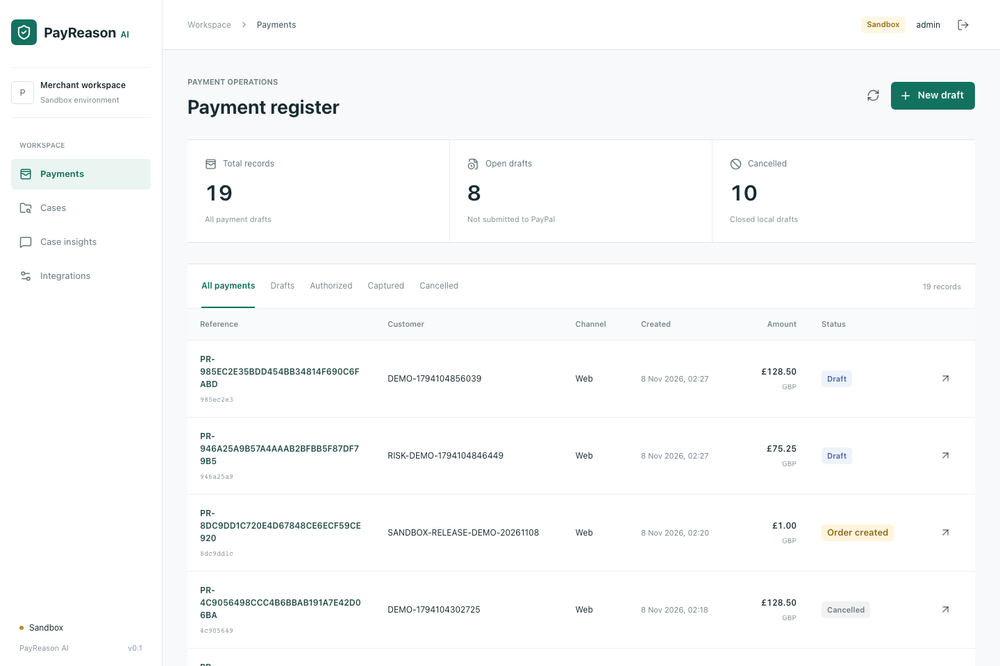

# PayReason AI

PayPal Sandbox payments with explainable risk assessment and human-controlled settlement.

**Demo edition, not production fraud prevention.** The ML model is trained on 12,000 synthetic records. No real-world fraud performance is claimed. Case insights use constrained database queries, not an LLM or RAG.

## Working features

- Session authentication, CSRF protection, exact decimal amounts and idempotent payment drafts.
- PayPal Sandbox order creation, buyer approval link, authorization, full capture, void and reconciliation.
- Persistent operation IDs and retry leases; unknown outcomes remain locked for recovery.
- Verified webhook receiver with receipt deduplication and authoritative provider reconciliation.
- Python logistic-regression inference with exact log-odds feature contributions and a committed JSON model.
- Immutable assessments, HOLD / RELEASE / BLOCK review decisions, reasons and actor-attributed history.
- Case queue filtered by channel, year and review decision.
- Latest-case and case-count questions with references to database records.
- React merchant console, Swagger contracts, Docker Compose and automated tests.

**Verification as of 8 November 2026:** real PayPal Sandbox authentication and order creation have succeeded, including a buyer-approval URL returned by PayPal. Buyer approval, authorization, capture, void and signed webhook delivery still require live Sandbox verification. Automated provider tests use an HTTP fixture. Missing credentials or model failures never produce fake payment results.

Public source: [richodia1/PayReason-AI](https://github.com/richodia1/PayReason-AI).
For evaluation, start with the [judge walkthrough](docs/judge-guide.md).



[View the working application gallery](docs/gallery.md).

## Quick start

Requires Docker with Compose. From the project directory:

```sh
cp .env.example .env
docker compose up --build -d
```

- Console: http://127.0.0.1:5180
- Java Swagger: http://127.0.0.1:8180/swagger-ui/index.html
- Python docs: http://127.0.0.1:8181/docs

Wait for the Java API to finish startup. Local demo sign-in: `admin` / `payreason-local-only`. All exposed ports bind to loopback. Replace the example passwords before any shared deployment. This bootstrap identity is administrator-only, not multi-tenant authentication.

For local-only testing with `admin` / `admin`, set `PAYREASON_ADMIN_PASSWORD=admin` and `PAYREASON_ALLOW_LOCAL_DEMO_LOGIN=true` in `.env`, keeping the username `admin`. This opt-in exception is disabled by default; all other passwords still require at least 12 characters. Disable it and choose a strong password before any shared deployment. Restart the API after changing these settings.

Without PayPal credentials, create a draft, assess a sample, record a review and explore Cases / Case insights. These operations use the real database and Python model. Checkout remains unavailable until credentials are configured.

Do not run the development launcher and Compose application containers on the same ports simultaneously. Stop containers with `docker compose down`; do not add `-v` unless you intentionally want to destroy the local database.

## PayPal Sandbox setup

Put `PAYPAL_CLIENT_ID`, `PAYPAL_CLIENT_SECRET`, `PAYPAL_WEBHOOK_ID` and the intended `PAYPAL_RETURN_URL` into the ignored `.env`. Never put the secret in browser variables or Git. Restart the API after changes.

Flow: draft -> Sandbox order -> buyer approval -> authorization -> assessment/review -> capture on RELEASE or void on BLOCK. A risk score never automatically captures money. Review and payment states remain separate.

[Detailed PayPal setup, API sources and recovery limits](docs/paypal-sandbox.md)

## Technology and layout

```text
apps/web/                  React, TypeScript, Material UI, Vite
services/platform-api/     Java 21, Spring Boot 4, PostgreSQL, Flyway
services/ai-service/       Python 3.12, FastAPI, JSON model inference
ml/training/              Reproducible synthetic-data training
ml/evaluation/            Measured synthetic experiment results
docs/                     Architecture, model card, demo and verification
scripts/                  Local lifecycle and source packaging
```

Java domains retain entities, enums, repository, services, controller and dto layers where needed. The original project is not a runtime dependency. No private documents or customer data are included.

## Local development

Requires Java 21, Node 24+, Python 3.12+ and Docker for PostgreSQL. Set JAVA_HOME to Java 21; on macOS use `export JAVA_HOME=$(/usr/libexec/java_home -v 21)`.

```sh
./mvnw verify
npm --prefix apps/web ci
python3 -m venv services/ai-service/.venv
services/ai-service/.venv/bin/python -m pip install -r services/ai-service/requirements-dev.txt
node scripts/dev.mjs start
```

The macOS/Linux launcher creates a local `.env` if absent, starts PostgreSQL and selects free application ports. It prints the actual URLs and saves logs under ignored `.local/`. Stop with `node scripts/dev.mjs stop`; inspect with `node scripts/dev.mjs status`.

## Tests

```sh
./mvnw verify
npm --prefix apps/web test
npm --prefix apps/web run build
services/ai-service/.venv/bin/python -m pytest services/ai-service/tests
```

With the application running:

```sh
cd apps/web
npx playwright install chromium --only-shell
npm run test:e2e
```

Browser tests create synthetic draft/case records and retain them in the local database. Set PAYREASON_WEB_URL for another port, and PAYREASON_ADMIN_USERNAME / PAYREASON_ADMIN_PASSWORD for changed local credentials.

Java tests exercise authentication, migrations, review gates, provider retries, capture/void, webhook rejection/deduplication and query filters. The provider is a local HTTP fixture. Python tests verify exact explanation reconstruction, input validation and model-unavailable failure. See [verification](docs/verification.md).

## Model and evidence

The model artifact is included; no training is needed to start. The optional training command, data generator, feature contract, evaluation split and limitations are in the [model card](docs/model-card.md). Do not represent synthetic metrics as real-payment results.

Example questions: "What is the latest case?", "How many cases?", "How many blocked cases from mobile this year?", "How many cases from web in 2026?". Unsupported questions return a clear error. Counts use all matching database rows; displayed evidence is limited to five records. A case or block is not confirmed fraud.

## Upload and demonstration

```sh
node scripts/package-source.mjs
```

Creates a source-only ZIP under ignored `.local/releases/`, checks its manifest and excludes local environment files, databases, dependencies and build output. Review the archive before public distribution. The script does not upload or push anything.

[Timed demonstration script](docs/demo-script.md) / [Submission text and checklist](docs/submission.md) / [Milestones](docs/roadmap.md) / [Provenance](docs/provenance.md)

## Deployment limits

Sandbox only. No production payment processing, refunds/disputes, partial captures, reauthorization, scheduled reconciliation, multitenancy, reviewer roles, federation, MFA, rate limiting, retention policy or production model governance. Python inference belongs on a private network; it has no standalone public authentication. The optional RabbitMQ profile is infrastructure only; no consumers are wired.

Before exposing any service publicly, add HTTPS, strong secrets, appropriate identity/access controls, network restrictions and an operational recovery process. Do not use demo credentials or synthetic risk scores for real money.

## License

Apache-2.0. See LICENSE.
