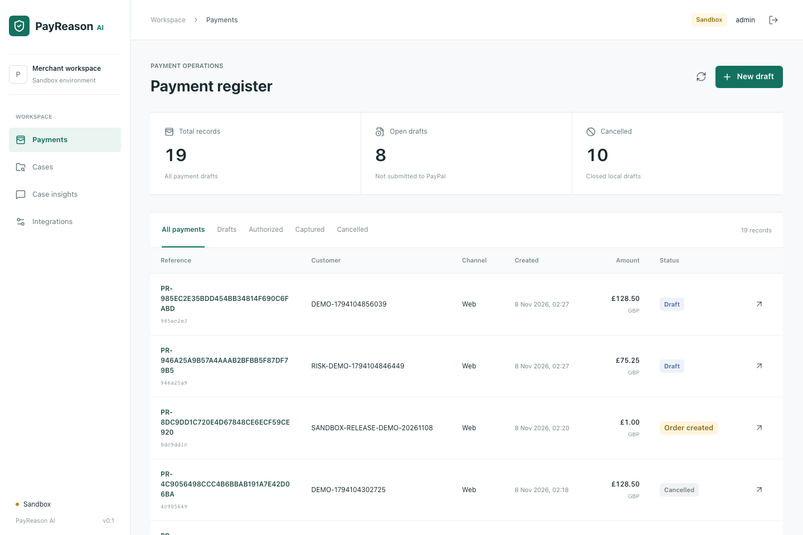
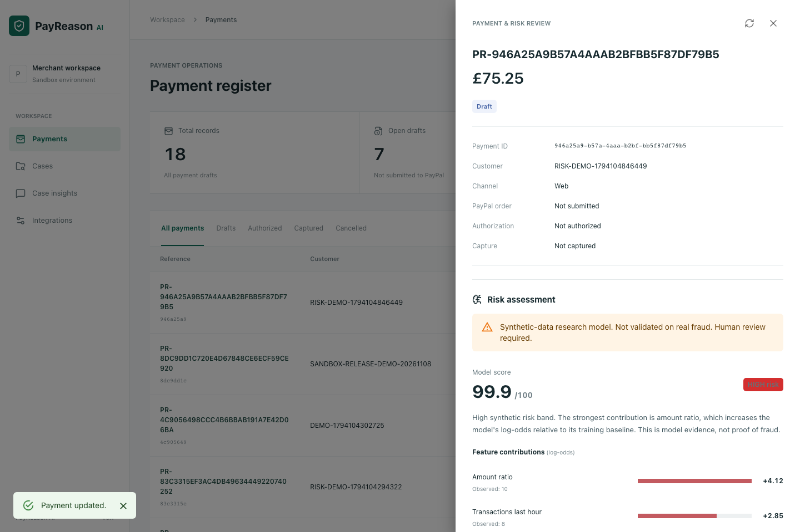
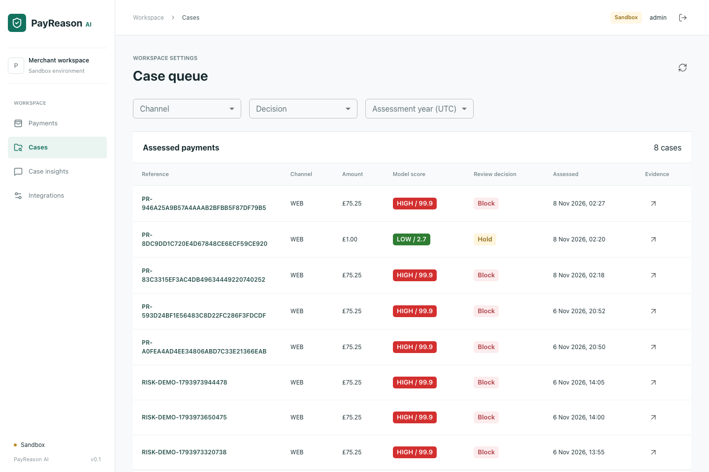
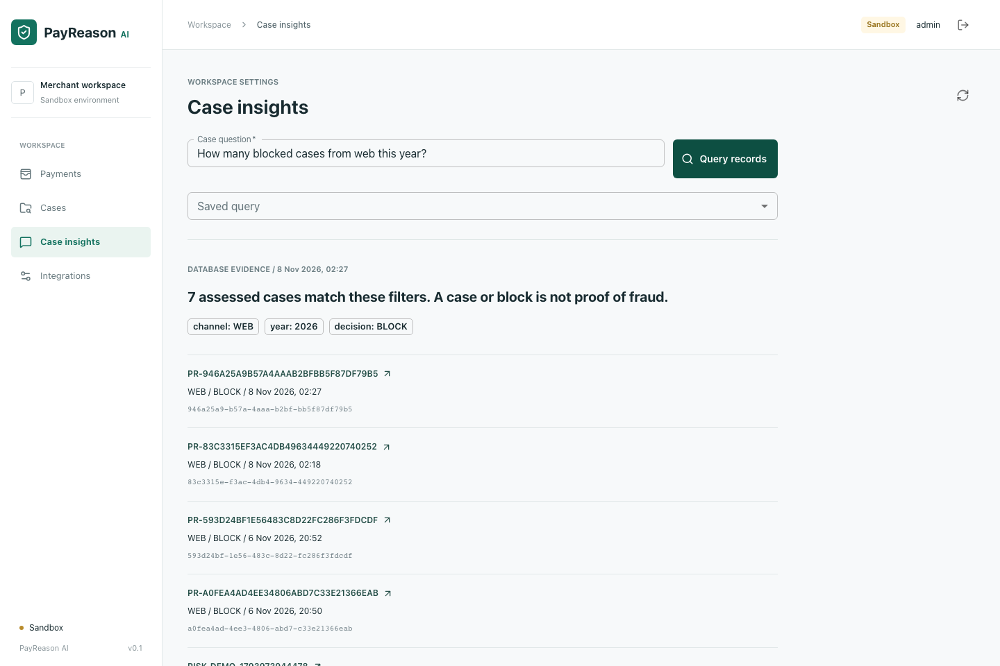

# Application gallery

Captured from the running application on 8 November 2026. All records shown are
fictional demonstration or automated-test records, not real customer payments.
The four PNGs are 1440 x 960 (3:2) and each is below 5 MB, suitable for the Devpost
image gallery. These screenshots do not demonstrate completed PayPal settlement.

## Payment register

Server-generated references, payment states and the merchant workspace.

## Risk explanation

An actual synthetic-model result with observed inputs and exact feature
contributions. A high score is not proof of fraud.

## Case queue

Persisted assessments and human review decisions, filterable by channel and year.

## Case insights

A database-backed count with case references. This is constrained reporting,
not an LLM-generated answer.

